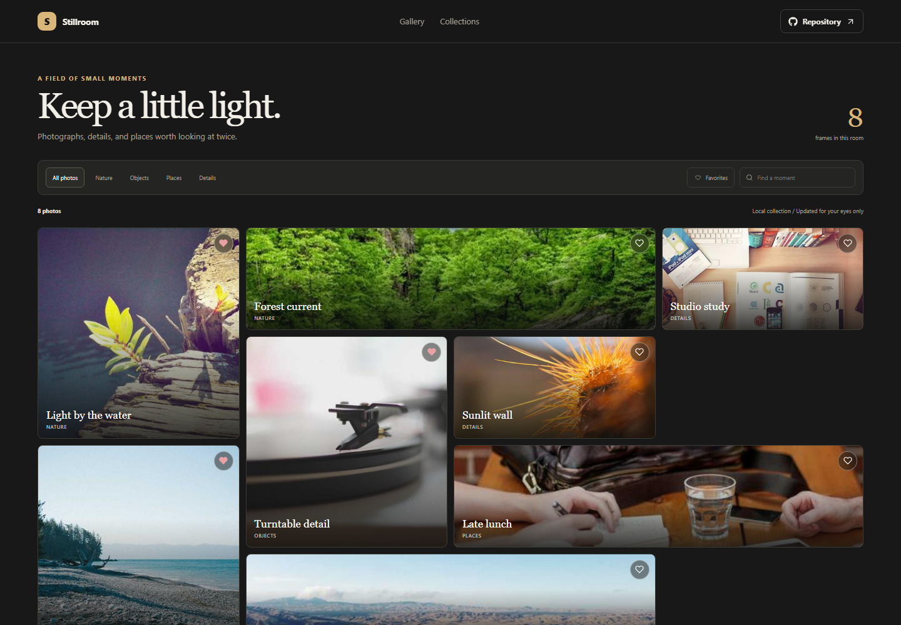

# Photo Gallery Viewer

Stillroom is a quiet gallery for browsing a small collection of locally stored photographs and keeping favorite details close.

**Live site:** [https://a2rp.github.io/photo-gallery-viewer/](https://a2rp.github.io/photo-gallery-viewer/)

## Interface

Collection filters organize the photo mosaic into Nature, Objects, Places, and Details. Search and a Favorites filter narrow the visible photos. Selecting a photo opens a large viewer with its caption and a download link.

## Features and use

Choose a collection, search captions, or filter to favorites. Select a photo to open it, use Save to toggle its favorite state, and choose Download to save the image file. Escape, the close button, or a click on the dark background closes the viewer.

## Data and limits

The gallery photos are bundled as local image files. Favorite selections are saved in localStorage in the current browser. No photos are uploaded.

## Run locally

Use Node.js and npm, then run these commands from the project folder:

```sh
npm install
npm run dev
```

Run ESLint and create a production build with:

```sh
npm run lint
npm run build
```

## Deployment

The public app is published with GitHub Pages. Build and publish the current version with:

```sh
npm run deploy
```

Vite builds with the /photo-gallery-viewer/ project-page base path.

## Future improvements

These are ideas and are not implemented yet:

- Add user-created albums and photo captions.
- Support importing a private local folder and exporting a favorites list.

## Links

- Portfolio: [https://www.ashishranjan.net](https://www.ashishranjan.net)
- GitHub: [https://github.com/a2rp](https://github.com/a2rp)
- CodePen: [https://codepen.io/ash1198](https://codepen.io/ash1198)
- LinkedIn: [https://www.linkedin.com/in/aashishranjan](https://www.linkedin.com/in/aashishranjan)
- Facebook: [https://www.facebook.com/theash.ashish/](https://www.facebook.com/theash.ashish/)
- YouTube: [https://www.youtube.com/@ashishranjan-ashz?sub_confirmation=1](https://www.youtube.com/@ashishranjan-ashz?sub_confirmation=1)
- Email: [mailto:ash.ranjan09@gmail.com](mailto:ash.ranjan09@gmail.com)

## Support

- Support: [https://a2rp-donation-page.netlify.app/](https://a2rp-donation-page.netlify.app/)
- Buy Me a Coffee: [https://buymeacoffee.com/ashishranjan](https://buymeacoffee.com/ashishranjan)
- Patreon: [https://www.patreon.com/ashishranjan](https://www.patreon.com/ashishranjan)